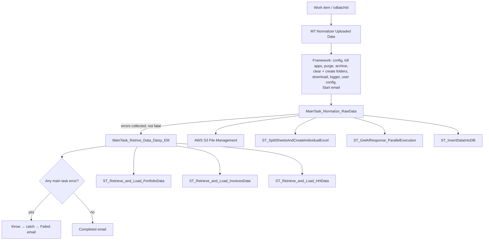
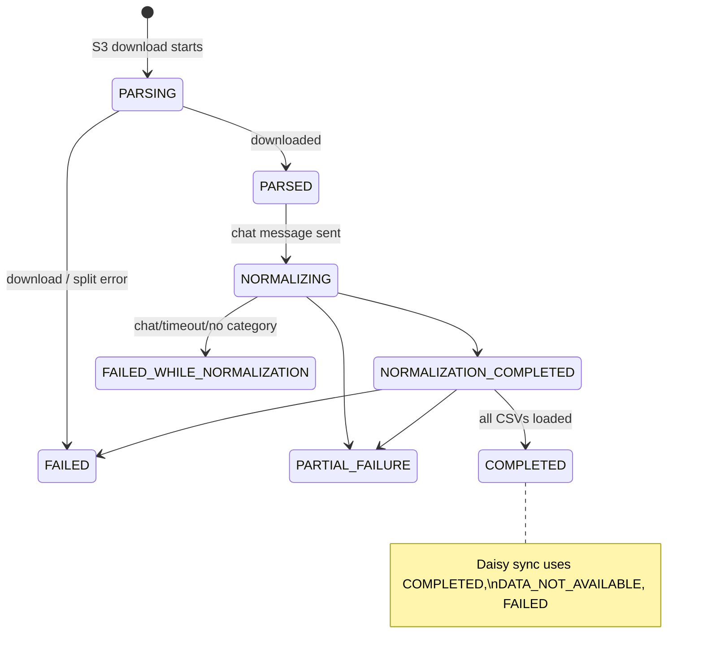
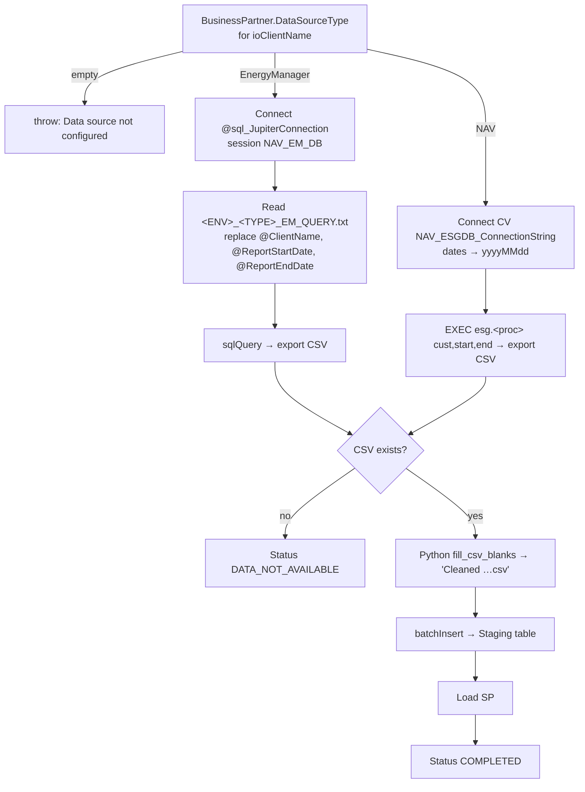

# SECR – Normalizer Uploaded Data: Design Document

Process: **Environmental Social and Governance → Streamlined Energy & Carbon Reporting (SECR)**
Entry point: `Tasks/MasterTasks/MT Normalizer Uploaded Data`
Author of the bots: Anuj Kumar

This document describes how the master task and its two main tasks, plus every sub task they call, are designed. It is written from the bot JSON in this repository.

---

## 1. Purpose

A user uploads one or more files for an SECR report in the ESG web app. The upload is stored as a **batch** (`FileUploadBatch`) with one row per file in `UploadedFile`. The bot receives the `BatchId` and does two independent jobs:

| Job | Main task | What it handles |
|---|---|---|
| **Normalize raw data** | `MainTask_Normalize_RawData` | Files the user actually uploaded (Excel/CSV in S3). They are split by sheet, sent to an AI agent (Odin) to be normalized into a standard CSV layout per category, then bulk-loaded into ESG DB staging tables and merged by stored procedures. |
| **Daisy / Energy Manager sync** | `MainTask_Retrive_Data_Daisy_EM` | "Virtual" files whose `FileName = 'Source: Daisy'`. No file is uploaded; the bot pulls Portfolio, Invoice or Half-Hourly data for the client and report period directly from the source system (**Energy Manager** or **NAV**) and loads it the same way. |

Both jobs end in the same place: data in ESG DB (MySQL on AWS RDS) and a per-file processing status in `UploadedFile.ProcessingStatusId`.

---

## 2. Task hierarchy

```
MT Normalizer Uploaded Data                          (MasterTasks)
├── Framework/ReadMainConfig, KillRunningApplications, DeleteOlderFiles,
│   ArchiveFolders, ClearLocalFolders, CreateFolderStructure, DownloadFolders,
│   ReadUserConfig, SendEmailNotification, UploadFolders      (Reusable/Framework)
│
├── MainTask_Normalize_RawData                       (SubTasks)
│   ├── ESG Common Utility/…/AWS S3 File Management  (download each file from S3)
│   ├── ST_SplitSheetsAndCreateIndividualExcel       (Python/openpyxl: 1 workbook per sheet)
│   ├── ST_GetAIResponse_ParallelExecution           (Odin AI agent: submit + poll)
│   ├── [inline Python] download_file                (download normalized CSVs)
│   ├── ST_InsertDataIntoDB                          (clean CSV → staging table → Load SP)
│   └── Framework/ErrorHandler                       (on exception)
│
└── MainTask_Retrive_Data_Daisy_EM                   (SubTasks)
    ├── ST_Retrieve_and_Load_PortfolioData           (CategorySelected = 'Portfolio')
    ├── ST_Retrieve_and_Load_InvoicesData            (CategorySelected = 'Invoices')
    ├── ST_Retrieve_and_Load_HHData                  (CategorySelected = 'Half Hourly Data')
    └── Framework/ErrorHandler                       (on exception)
```



---

## 3. Common design conventions

All tasks follow the same framework template:

- **Header comments**: Author / Purpose / Notes / Change History.
- **One outer `Try / Catch / Finally`**.
  - *Try* is split into `Step`s: `INITIAL ASSIGNMENTS` → (disabled) unit-test step → `User Config Variable Assignment` → `IMPLIMENTATION` → `CLEANUP & FINALIZE`.
  - *Catch* sets `sBotStatus = @gStatus_TechnicalException` (or `sErrorType` when a child reported one), escapes `'` in `sErrorMessage`, logs it, and calls `Reusable/Framework/ErrorHandler` (screenshot + email).
  - *Finally* closes any DB / Python session that is still open, guarded by boolean flags (`bDBConnection`, `bESGDBConnection`, `bNAV_EMDBConnection`, `bPythonSessionOpen`).
- **Standard outputs** of every sub task: `sTaskName`, `sErrorMessage`, `nErrorLineNumber`, `sBotStatus`, `sBotComments`, `sErrorType`. The caller checks `sErrorMessage <> ""`.
- **Config** arrives in `dConfig` (dictionary built by `ReadMainConfig` + `ReadUserConfig` from `Docs/Config/MainConfig.xlsx`). Keys used: `User`, `CorrelationId`, `LocalFolders` (`Log`, `Output`), `ProcessConfig`, `Applications`, `Folders`, `DefaultEmails`.
- **`ProcessConfig` keys**: `ESGDBServerName`, `DatabaseName`, `MySQL_Port`, `NAVDBServerName`, `Environment` (DEV/UAT/PROD), `Agent_Project_ID`, `Agent_ID`, `ENV_Base_URI`.
- **Credentials** come from Credential Vault locker **ESG Locker**:
  - `ESGDB MySQL` (Username, Password)
  - `AWS_S3` (ACCESS_KEY_ID, SECRET_KEY, ESG_BUCKET_NAME, REGION)
  - `AA ESG EKB Credential` (API_KEY, API_SECRET) – Odin AI
  - `NAV_ESGDB_ConnectionString` (ConnectionString)
  - Energy Manager uses global value `@sql_JupiterConnection`.
- **MySQL driver**: `ESG Common Utility/Driver/mysql-connector-j-26.7.0.jar` (user-defined JDBC driver).
- **Logging**: Logger package (`log4aa.yaml`), `reference` field carries `Batch Id` / `File Id` for traceability; `CorrelationId` comes from `Logger.start`.
- **SQL string safety**: before embedding text in SQL, `\` is doubled and `'` is doubled (`''`).

---

## 4. Master task – `MT Normalizer Uploaded Data`

### Inputs / outputs

| Variable | Dir | Meaning |
|---|---|---|
| `ioBatchId` | IN | Batch to process. If empty, falls back to `workItem{BatchID}` (Workload / queue mode). |
| `workItem` | IN | Work-queue record. |
| `workItemResult` | OUT | `Success` or `Failed: <message>`. |

### Flow

| # | Step | Behaviour |
|---|---|---|
| 1 | Initialize (Read Main Config) | `ReadMainConfig(MainConfig.xlsx, sMasterTaskName)` → `dConfig`; extracts `Applications`, `Folders`, `LocalFolders`, `DefaultEmails`. Fatal on error. |
| 2 | Kill Applications | `KillRunningApplications(tApplications)`. Fatal. |
| 3 | Delete older files | `DeleteOlderFiles(tFolders)`. **Non-fatal** (throw is disabled). |
| 4 | Archive folders | `ArchiveFolders`. Fatal. |
| 5 | Clear local folders | `ClearLocalFolders`. Fatal. |
| 6 | Create folder structure | `CreateFolderStructure`. Fatal. |
| 7 | Download files | `DownloadFolders` (remote → local). Fatal. |
| 8 | Initialize Log | `Logger.start` with `log4aa.yaml`; log folder = `LocalFolders.Log`; returns `sCorrelationId`, stored in `dConfig{CorrelationId}`; `bLoggerStarted = true`. |
| 9 | Read User Config | `ReadUserConfig(dConfig)`. Fatal. Then `bSendDefaultEmail = false` (from here on, use the templated email). |
| 10 | Email: Started | `SendEmailNotification(sEmailType="Started")`. Fatal. |
| 11 | Main Task Normalizer | Resolve `ioBatchId` (input → work item → throw if both empty). Run `MainTask_Normalize_RawData(dConfig, ioBatchId)` inside its own try/catch. A failure is **appended to `sMainTaskErrors`**, not thrown. |
| 12 | Main Task Daisy Sync | Run `MainTask_Retrive_Data_Daisy_EM(dConfig, ioBatchId)` the same way. Runs even if step 11 failed. |
| 13 | Check main task results | If `sMainTaskErrors` is not empty → throw `One or more main tasks failed: …`. |

**Catch**: message box (auto-closes in 3 s), log the error if the logger started, and re-throw to Control Room when `bShowErrorOnControlRoom = true` (default).

**Finally** – each block in its own try/catch so one cleanup failure does not stop the others; cleanup errors are recorded in `sErrorMessage` only if no earlier error exists:
1. `UploadFolders` (local → remote).
2. Set `sEmailType` = `Failed`/`Completed`, build `sEmailMessage`, set `workItemResult`.
3. Send end email: if config never loaded (`bSendDefaultEmail = true`) send a plain SMTP mail using `DefaultEmails` + `@gSMTP_Host/@gSMTP_Port`; otherwise `SendEmailNotification`.
4. `KillRunningApplications`.
5. `ClearLocalFolders`.
6. `Logger.end` (if started).

---

## 5. Main task – `MainTask_Normalize_RawData`

Inputs: `dConfig`, `ioBatchId`. DB session: **`ESG_Session`**.

### 5.1 Pick the files of the batch

```sql
SELECT FB.BatchId, FB.ReportId, R.ClientId, R.ReportStart, R.ReportEnd,
       BP.BusinessPartnerName, UF.FileId, UF.FileName, UF.StoragePath,
       UF.FileVersion, UF.IsDeleted, UF.IsValid
FROM FileUploadBatch FB
LEFT JOIN UploadedFile UF   ON UF.BatchId = FB.BatchId
LEFT JOIN Report R          ON FB.ReportId = R.Id
LEFT JOIN BusinessPartner BP ON R.ClientId = BP.BusinessPartnerId
LEFT JOIN RefReportType RT  ON R.ReportTypeId = RT.ReportTypeId
WHERE FB.BatchId = :ioBatchId AND UF.IsDeleted = 0 AND UF.IsValid = 1
  AND RT.Code = 'SECR' AND UF.FileName <> 'Source: Daisy';
```
Row 0 gives `sReportId`, `sReportStartDate`, `sReportEndDate`, `sClientName`.

### 5.2 Pipeline

```mermaid
flowchart LR
    A[tBatchDetailsTable] -->|per file| B[S3 download<br/>PARSING→PARSED/FAILED]
    B --> T1[tS3FileTable<br/>FileID, DownloadFilePath]
    T1 --> C[ST_SplitSheets…]
    C --> T2[tSplittedFileTable<br/>FileID, SplittedFilePath]
    T2 --> D[ST_GetAIResponse…<br/>NORMALIZING→NORMALIZATION_COMPLETED]
    D --> T3[tNormalizedCSVFileLinkTable<br/>FileID, NormalizedCSVLink, FileName]
    T3 --> E[Python download_file]
    E --> T4[tNormalizedCSVFileTable<br/>FileID, NormalizedCSVFilePath]
    T4 --> F[ST_InsertDataIntoDB per CSV]
    F --> G[COMPLETED / PARTIAL_FAILURE / FAILED per file<br/>Batch → COMPLETE]
```



| Step | Design |
|---|---|
| **Variable Assignments** | DB settings from `ProcessConfig`, creds from vault, `sDownloadFolder` = `sExcelSplitFolderPath` = `LocalFolders.Output`. |
| **Check uploaded file by BatchId** | Connect MySQL, run query 5.1. |
| **Download File from S3** | For each row (own try/catch): status → `PARSING`; call `AWS S3 File Management` (`ioS3ActionType="Download"`, `StoragePath` → `Output\<FileName>`). If `sErrorMessage` set or `aDLLOutput` does not contain `Success` → `FAILED` + `StatusDescription`, continue. On success add row to `tS3FileTable` and status → `PARSED`. |
| **Split sheets** | `ST_SplitSheetsAndCreateIndividualExcel(ioS3FileTable)`. On error: mark the returned `sFailedFileIDs` as `FAILED` (via `FIND_IN_SET`); if no IDs came back, mark every `PARSED` file in the batch `FAILED`. |
| **AI normalization** | `ST_GetAIResponse_ParallelExecution(ioFileToNormalizePathTable = tSplittedFileTable)`. On error: files still `NORMALIZING` → `FAILED_WHILE_NORMALIZATION`. |
| **Download normalized file** | Opens an inline Python script (`download_file(link, output_path)` – streams the link to the output folder, filename inferred from URL). Per link: success → add `{FileID, NormalizedCSVFilePath}`; failure → status `FAILED` (appended description) and add the row with an **empty path** so the next step counts it as failed. |
| **Insert data to Database** | Iterates `tNormalizedCSVFileTable` (one row per category CSV; a source file can produce several). Uses a **control-break** on `FileID`: when the file id changes, the previous file's final status is written – `COMPLETED` (0 fails), `FAILED` (0 successes) or `PARTIAL_FAILURE`, with the accumulated error text. Each CSV is loaded by `ST_InsertDataIntoDB(ioCSVFilePath, ioInputFolderPath, ioFileId, ioReportId)`. The last file is closed after the loop. |
| **CLEANUP & FINALIZE** | `FileUploadBatch.BatchStatusId` → `COMPLETE`; disconnect. |
| **Catch** | Files still `PARSING` → `FAILED`, still `NORMALIZING` → `FAILED_WHILE_NORMALIZATION` (only if DB is connected); ErrorHandler. |
| **Finally** | Disconnect DB, close Python session if open. |

### 5.3 File status lifecycle (`RefFileProcessingStatus.Code`)



---

## 6. Sub tasks of the Normalize flow

### 6.1 `ST_SplitSheetsAndCreateIndividualExcel`

| | |
|---|---|
| **In** | `dConfig`, `ioExcelSplitFolderPath`, `ioS3FileTable` (FileID, DownloadFilePath) |
| **Out** | `ioSplittedFileTable` (FileID, SplittedFilePath), `sFailedFileIDs` |
| **Tech** | Python session with `split_all_sheets_values_only(source_file, output_dir, output_prefix="Sheet_")` (openpyxl, values-only for speed). Returns JSON `{status, error, created_files:[{status, file_path, sheet_name, error}]}`. |

Logic per file (own try/catch):
- `.xlsx`/`.xlsm` → split; every sheet with `status = success` becomes a row. Failing sheets are logged; the file only fails if **all** sheets failed.
- Any other extension (e.g. CSV) → passed through unchanged as one row.
- File-level errors add the id to `sFailedFileIDs` (`id;id;…`) and continue.
- After the loop, if any file failed the task throws, so the caller marks those files `FAILED`; successfully split files are still in the output table.

### 6.2 `ST_GetAIResponse_ParallelExecution`

| | |
|---|---|
| **In** | `dConfig`, `ioFileToNormalizePathTable` (FileID, SplittedFilePath) |
| **Out** | `tNormalizedCSVFileLinkTable` (FileID, NormalizedCSVLink, FileName) |
| **API** | Odin AI (`ENV_Base_URI`, headers `X-API-KEY` / `X-API-SECRET`). DB session `AI_ESG_Session`. |

**Phase 1 – submit (fire and forget)**, per split file:
1. `POST /chat/create {project_id, name=<file name>}` → `chat_id`. No id → throw (row-level).
2. `POST /v4/chat/message` (multipart: `project_id`, `agent_id`, `chat_id`, message *"extract and make sure not to skip any records then normalize and return the csv file link"*, plus the file). Status → `NORMALIZING`.
   - A **timeout is treated as accepted** (logged WARN; response will be polled).
   - Any other error → `FAILED_WHILE_NORMALIZATION`, chat id blanked.
3. Row `{FileID, ChatID, FileName}` added to `tChatIDTable` (blank ChatID = counted as failed later).

**Phase 2 – collect**, per chat (same FileID control-break as in 5.2):
- Do-while poll `GET /project/{projectId}/chat/{chatId}` until `$.messages[0].json_response` is present. Wait **40 s** between attempts; after **15 attempts (~10 min)** → timeout, ErrorHandler email, counted as failed.
- For each category key in `lCategoryNodeList` = `portfolio, landlord, transport, other_fuels, metrics, energy_efficiency_narrative, invoice, half_hourly_data`, read `json_response.normalized_csv_file_links.<key>`. Each non-empty link → row in the output table, success count +1, and `UploadedFile.CategoryRecognized` is updated with the readable category name.
- Final status per source file: `NORMALIZATION_COMPLETED` / `FAILED_WHILE_NORMALIZATION` / `PARTIAL_FAILURE`.

### 6.3 `ST_InsertDataIntoDB`

| | |
|---|---|
| **In** | `dConfig`, `ioCSVFilePath`, `ioInputFolderPath`, `ioFileId`, `ioReportId` |
| **DB session** | `Default` |

1. **Category** is derived from the CSV file name around the `_ESG` token (e.g. `Energy_Efficiency_Narrative_ESG_Normalized_Data_<ts>.csv`). Empty → throw.
2. **Clean** with Python `fill_csv_blanks(input_file, output_file=<input folder>\Cleaned_<category>.csv, fill_value="NA", file_id)` – fills blanks with `NA`, cleans newlines, adds a `FileID` column; returns JSON with `status` and `result.rows_processed`.
3. If `rows_processed <= 1` (header only) → `Stop task` (treated as success, nothing loaded).
4. **Bulk insert** (`Database.batchInsert`, start row 2, explicit column mapping) into the staging table, then call the **Load stored procedure** (`p_FileId`, `p_ReportId`, out `p_Message`). The output message must contain `success` (Invoice: `successful`) or the task throws.

| Category (from name, case-insensitive) | Staging table | Stored procedure(s) |
|---|---|---|
| Portfolio | `Staging_Portfolio` | `LoadPortfolioData` → `UpdatePortfolioDerivedFields(p_ReportId)` |
| landlord | `Staging_Landlord` | `LoadLandlordData` |
| transport | `Staging_Transport` | `LoadTransportData` |
| other_fuels | `Staging_Other_Fuels` | `LoadOtherFuelData` |
| metrics | `Staging_Metrics` | `LoadMetricInputData` |
| Energy_Efficiency_Narrative | `Staging_Energy_Efficiency_Narrative` | `LoadEnergyEfficiencyNarrativeData` |
| Invoice | `Staging_Invoices` | `LoadInvoiceData` → `CalculateInvoiceData(p_ReportId, p_CreatedBy)` (120 s timeout) |
| half_hourly_data | `Staging_HHData` | `LoadHHData(p_FileId, p_ReportId, p_CreatedBy)` |
| anything else | – | throw `Unrecognized Category` |

The status of `UploadedFile` is **not** set here; the caller (5.2) sets it from the returned `sErrorMessage`.

---

## 7. Main task – `MainTask_Retrive_Data_Daisy_EM`

Inputs: `dConfig`, `ioBatchId`. DB session `ESG_Session`.

1. Same batch query as 5.1 but with `UF.CategorySelected` and the filter **`UF.FileName = 'Source: Daisy'`**.
2. Row 0 gives report id, period and client name.
3. Loop over each Daisy row; dispatch on `CategorySelected`:

| `CategorySelected` | Sub task |
|---|---|
| `Portfolio` | `ST_Retrieve_and_Load_PortfolioData` |
| `Invoices` | `ST_Retrieve_and_Load_InvoicesData` |
| `Half Hourly Data` | `ST_Retrieve_and_Load_HHData` |

   Each gets `dConfig, ioReportId, ioFileId, ioClientName, ioReportStartDate, ioReportEndDate`. If the child returns an error it is **logged and `sErrorType` copied, but the `throw` is disabled** – the loop moves on to the next file. The child has already set the file status to `FAILED`.
4. CLEANUP: disconnect. (Unlike Normalize, the batch status is not set to `COMPLETE` here.)

---

## 8. Sub tasks of the Daisy flow – `ST_Retrieve_and_Load_{Portfolio|Invoices|HH}Data`

The three tasks are copies of one design; only the query files, source procedure, staging table, column mapping and load SP differ.



| | Portfolio | Invoices | HH Data |
|---|---|---|---|
| EM query file | `<ENV>_PORTFOLIO_EM_QUERY.txt` | `<ENV>_INVOICE_EM_QUERY.txt` | `<ENV>_HHD_EM_QUERY.txt` |
| NAV procedure | `esg.PortfolioData` | `esg.InvoiceData` | `esg.hhdata` |
| CSV name | `Portfolio_FileID<id>_ReportID<id>_<ts>.csv` | `Invoices_…` | `HHD_…` |
| Staging table | `Staging_Portfolio` | `Staging_Invoices` | `Staging_HHData` |
| Load SP | `LoadPortfolioData` (expects `successful`) | `LoadInvoiceData` (expects `successful`) → `CalculateInvoiceData` (fails if `p_Status = ERROR`) | `LoadHHData` (+`p_CreatedBy`, expects `success`) |

Status written to `UploadedFile`: `COMPLETED` (description cleared), `DATA_NOT_AVAILABLE` (no CSV produced), or `FAILED` in the catch block (description truncated to 2000 chars). DB sessions: `ESGDB` (MySQL) and `NAV_EM_DB` (source), both closed in *Finally*.

---

## 9. External dependencies

| Dependency | Used by | Detail |
|---|---|---|
| ESG DB – MySQL (AWS RDS, eu-west-2) | all | Tables: `FileUploadBatch`, `UploadedFile`, `Report`, `BusinessPartner`, `RefReportType`, `RefFileProcessingStatus`, `RefBatchStatus`, `Staging_*`; SPs listed in 6.3 and 8. |
| AWS S3 | Normalize | Via `ESG Common Utility/Tasks/SubTasks/AWS S3 File Management`. |
| Odin AI (`api.getodin.ai`) | Normalize | Chat create, message, poll. |
| Energy Manager DB | Daisy | Connection string in global value `@sql_JupiterConnection`; SQL in `Docs/Config/*_EM_QUERY.txt`. |
| NAV / Sugar SQL Server | Daisy | Connection string in CV; `esg.*` procedures. |
| Python (bot runner) | Split, Normalize, Insert, Daisy | `openpyxl` needed for split. |
| Reusable Framework bots | Master + all catch blocks | `Automation Anywhere/Bots/Reusable/Framework/*`. |
| `Docs/Config/MainConfig.xlsx`, `log4aa.yaml` | Master | Config and logging. |

---

## 10. Observations and risks found during review

These are things in the current bot code that look unintended or worth confirming:

1. **Daisy failures never reach the master.** In `MainTask_Retrive_Data_Daisy_EM` the `throw` after each child is disabled, so `sErrorMessage` stays empty and the master reports *Completed* even when a Portfolio/Invoice/HH load failed. Only the file status in the DB shows the failure.
2. **UAT/PROD query is never loaded.** In all three `ST_Retrieve_and_Load_*` tasks, DEV checks `DataSourceType = "EnergyManager"` but UAT and PROD check `"Energy Manager"` (with a space). Everywhere else the value is `EnergyManager`, so in UAT/PROD `sRetrieveQuery` stays empty for Energy Manager clients.
3. **Invoices PROD reads the Portfolio query.** `ST_Retrieve_and_Load_InvoicesData` loads `PROD_PORTFOLIO_EM_QUERY.txt` for PROD, and `Docs/Config/PROD_INVOICE_EM_QUERY.txt` does not exist.
4. **Unmatched categories are silently skipped.** A Daisy row with any other `CategorySelected` gets no status update.
5. **Batch status order.** Only the Normalize flow sets `FileUploadBatch` to `COMPLETE`, and it runs first, so the batch is marked `COMPLETE` before the Daisy sync has run.
5a. **Batches with only one kind of file.** Both main tasks read `$tBatchDetailsTable[0]{…}$` straight after the query with no row-count check. If a batch has only Daisy rows (Normalize query returns nothing) or only uploaded files (Daisy query returns nothing), that read most likely raises an index error, the main task fails, and the master reports *Failed* even though nothing was wrong. A `row count = 0 → log and skip` guard in each main task would avoid this (needs confirming in a test run).
6. **`sFileName` in the normalized-file download step is not mapped** from the loop (only `FileID` and `NormalizedCSVLink` are), so error descriptions may show a stale file name. Likewise the insert loop maps a `FileName` column that `tNormalizedCSVFileTable` does not define.
7. **Inconsistent SP success checks** – some look for `success`, others `successful`; `CalculateInvoiceData` parameter is `p_CreatedBy` in `ST_InsertDataIntoDB` but `v_created_by` in `ST_Retrieve_and_Load_InvoicesData`.
8. **Plain-text secrets in disabled unit-test steps.** Several tasks (Normalize, Daisy, AI, Insert, Retrieve_and_Load_*) contain disabled `Step for unit testing` blocks with a hard-coded ESG DB username/password, Odin API key/secret, and a NAV connection string with a password. They are disabled but still committed to the repository and exported with the bot; they should be removed and the credentials rotated.
9. **`DeleteOlderFiles` errors are ignored** in the master (throw disabled) – probably intentional, but worth a comment.
10. The AI timeout (15 × 40 s ≈ 10 min per file, polled sequentially) means a batch with many files that time out can take a long time; files are submitted in parallel but collected one by one.
